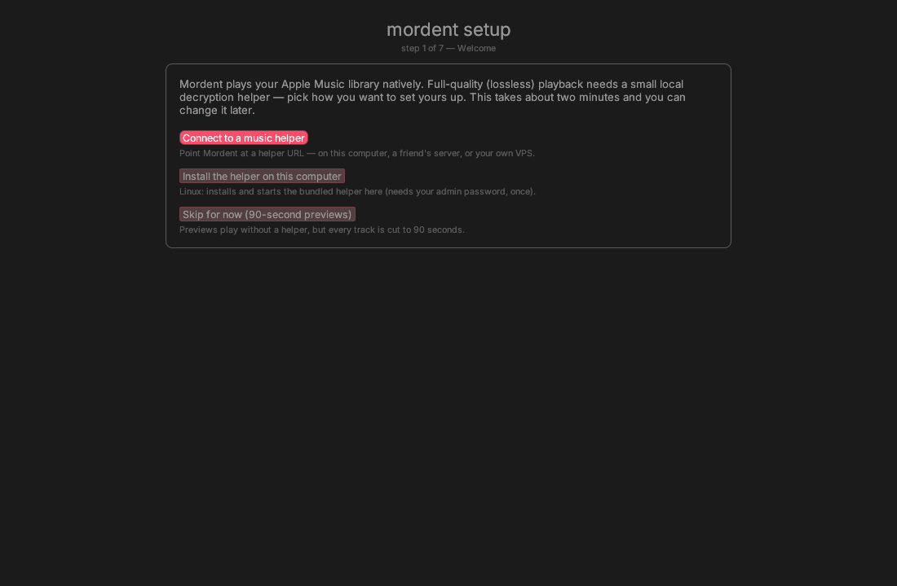
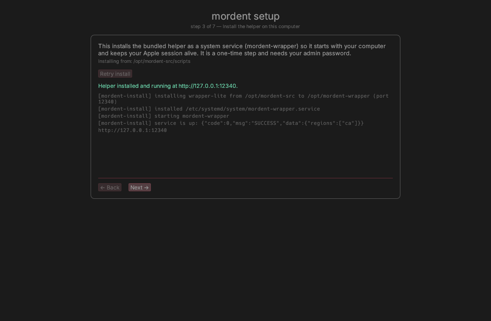

# Mordent — Apple Music, native and fast

[](https://github.com/mordentplayer/mordent/actions/workflows/ci.yml)

**[mordent.app](https://mordent.app/)** — landing page, downloads and the
anonymous [feedback form](https://mordent.app/feedback) (source: [`site/`](site/)).

A lightweight native Apple Music client for Linux (Rust + egui). Goals:
instant startup, minimal resource use, and going from wanting to listen to music -> song playing as fast as possible.

Full-quality playback (ALAC up to 24-bit / hi-res, word-synced lyrics) is
powered by [wrapper-lite], the FairPlay SAMPLE-AES decryption backend.
Catalog search and 90-second previews work anonymously; full-track playback
requires an active Apple Music subscription logged into the wrapper.

[spotifast]: https://github.com/crmne/spotifast
[wrapper-lite]: https://github.com/WorldObservationLog/wrapper/tree/lite

## Architecture

```
┌─────────────────────────────── mordent (single Rust binary) ─────────────────┐
│  egui UI ── queue / player bar / search                                      │
│     │                                                                        │
│  amp-api client          wrapper-lite client        streaming pipeline        │
│  · web bearer scrape  ── · /m3u8 manifest URLs    · HLS master→variant pick  │
│  · search / catalog      · /key FairPlay templates  · single-file fetch ahead  │
│  · previews              · /lyrics (word-synced)    · cbcs decrypt in-flight  │
│  · media-user-token*     · /status /license         · ALAC packets → symphonia│
└──────────────────────────────────────────────────────────────────────────────┘
                                        │ HTTP :12340
                        wrapper-lite (chroot'd Android-layer `lite` binary)
```

*optional — personalized library/playlists features.

## Install

Graphical all the way: download, double-click, done. The first run opens a
**guided setup wizard**, and every later run is the same windowed app — no
terminal at any point. (The wizard is described under
[First-run setup](#first-run-setup).)

### Linux — AppImage (any distro)

1. Download `mordent-<version>-x86_64.AppImage` from the
   [latest release](https://github.com/mordentplayer/mordent/releases/latest).
2. Once, in your file manager: **Properties → Permissions → “Allow executing
   file as program”** (downloads are not marked executable).
3. Double-click the file. The app starts.

The AppImage installs nothing by itself — it runs from wherever you saved it,
and deleting the file removes it. If you also want full-quality playback on
this computer, pick *Install the helper on this computer* in the wizard: it
installs the helper bundled inside the AppImage as a system service under
`/opt/mordent-wrapper` (that is the one step that needs your password, asked
for through a graphical `pkexec` dialog). The image carries a `.desktop` entry
and a 256×256 icon, so desktop-integration tools (e.g. AppImageLauncher, or a
file manager's “Integrate” action) can add Mordent to your applications menu.

### macOS — Mordent.app

1. Download `Mordent-<version>-macos-aarch64.zip` (Apple Silicon) or
   `Mordent-<version>-macos-x86_64.zip` (Intel) and double-click it in Finder to
   unzip.
2. Drag **Mordent.app** into *Applications*.
3. **First launch: right-click the app → Open → Open.** The build is not
   code-signed or notarized, so Gatekeeper refuses a plain double-click the
   first time; approving once is remembered. (Signing with an Apple Developer
   ID and notarizing would remove this step — optional, not done yet.)

The FairPlay helper is Linux-only, so nothing is installed locally on a Mac:
the wizard's *Connect to a music helper* path points at a wrapper running
elsewhere — in Docker on your Mac, or on an always-on Linux box. Step-by-step
guide: [`docs/macos-container/README-friend.md`](docs/macos-container/README-friend.md).

### Windows — zip

1. Download `mordent-<version>-windows-x86_64.zip` and unzip it anywhere.
2. Double-click `mordent.exe`. The first time, SmartScreen warns about an
   unsigned app — click **More info → Run anyway** (one click, remembered
   afterwards).

`mordent.exe` carries no icon resource: embedding one needs a cross-compile
resource step, which is out of scope for now. The repository ships
[`assets/icon/mordent.ico`](assets/icon/mordent.ico) if you want the icon on a
desktop shortcut.

### Linux — one-line install (user directory, no root)

Installs under `~/.local` and adds a `Mordent` entry to your application menu —
no package manager, no `sudo`:

```sh
curl -fsSL https://github.com/mordentplayer/mordent/releases/latest/download/install.sh | bash
```

Prefer to read it before you run it? (Recommended for any `curl | bash`.)

```sh
curl -fsSLO https://github.com/mordentplayer/mordent/releases/latest/download/install.sh
less install.sh
bash install.sh
```

Options — the piped form takes them after `bash -s --`, e.g.
`… | bash -s -- --prefix /opt/mordent`:

| Flag | Meaning |
|---|---|
| `--prefix <dir>` | install prefix (default `$HOME/.local`; env `MORDENT_PREFIX`) |
| `--tag <tag>` | install a specific release (default: the latest; env `MORDENT_TAG`) |
| `--uninstall` | remove the install — keeps `~/.config/mordent` |
| `--yes` | non-interactive (implied when stdin is not a TTY) |

It lays out `share/mordent/` (`mordent`, `wrapper-lite`, `rootfs/`, `scripts/`,
`licenses/`, `assets/icon/`, `README.md`) plus the `bin/mordent` symlink, a
`.desktop` entry and icons; verifies the download against the release's
`SHA256SUMS` when the release ships one (otherwise it prints the computed hash
and a warning), and never calls `sudo`. Upgrading is just re-running it.
`--uninstall` removes the files but leaves your settings and login in
`~/.config/mordent`.

### Advanced — tarballs, scripts, source

The release page also keeps the plain tarballs
(`mordent-<version>-linux-x86_64.tar.gz` and `…-macos-<arch>.tar.gz`) for
scripted or system-wide installs; the Linux tarball contains exactly the payload
the AppImage is built from. To build from source see [Building](#building), and
for a hand-rolled wrapper setup see [Setup](#setup).

## Building

```sh
cargo build --release
```

## Setup

1. **wrapper-lite** (full playback):
   ```sh
   git clone -b lite https://github.com/WorldObservationLog/wrapper wrapper
   cd wrapper && mkdir build && cd build && cmake .. -DCMAKE_BUILD_TYPE=Release && make -j$(nproc)
   cd ..
   sudo ./wrapper-lite --login 'EMAIL:PASSWORD' --host 127.0.0.1 --port 12340
   # 2FA: echo CODE | sudo tee rootfs/data/2fa.txt  (while login waits)
   sudo ./wrapper-lite --host 127.0.0.1 --port 12340   # service mode
   ```
   Requires the Android NDK r23b at `wrapper/android-ndk-r23b/`
   (Google's CDN is blocked on some networks — the gvt1 mirror works:
   `https://redirector.gvt1.com/edgedl/android/repository/android-ndk-r23b-linux.zip`).

2. **config** `~/.config/mordent/config.toml` (created on first run):
   ```toml
   storefront = "us"                      # your country code
   wrapper_url = "http://127.0.0.1:12340"
   media_user_token = ""                  # optional: library features
   report_plays = true                    # report plays to Apple (Recently Played)
   cache_size_gb = 10                     # audio-cache budget; 0 disables
   check_updates = true                   # daily GitHub release check (see Updates)
   quality = "lossless"                   # lossless | high | data_saver (see Playback quality)
   ```

### Running the wrapper on macOS (or a home server)

The wrapper backend is Linux/x86-64, so on a Mac it runs in a Docker
container: [`docs/macos-container/README-friend.md`](docs/macos-container/README-friend.md)
is a step-by-step (non-technical) guide, with the `Dockerfile`/`compose.yaml`
and the container forensics in the same directory. Prefer an always-on Linux
box? Run the wrapper natively there and just point `wrapper_url` at it — see
[`docs/macos-container/README-home-server.md`](docs/macos-container/README-home-server.md).

## First-run setup

`Mordent` ships a guided setup wizard, so going from zero to playing music needs
no docs. The first `mordent ui` on a machine with **no** `~/.config/mordent/config.toml`
opens the wizard instead of the app; after that it starts normally. Re-run it
any time with:

```sh
mordent setup
```

…or from inside the player: **⚙ Settings → Setup → Run setup wizard**
(`ctrl+,` opens Settings). That re-opens the same wizard with the current
config as its starting values and returns to the player when it finishes —
the first-run auto-open is unchanged.

The wizard walks through:

1. **Welcome** — three ways to play: connect to a music helper (a wrapper URL —
   on this computer, a friend's server or your own VPS), install the bundled
   helper on this computer (Linux: runs the same `scripts/install-wrapper.sh`
   through `pkexec`), or skip for now (90-second previews).
2. **Wrapper URL** — type a URL and hit *Test connection*; on success it shows
   the regions the helper can serve and lets you pick your storefront.
3. **Local install** (Linux only) — installs and starts the helper as a system
   service, streaming the installer's output live.
4. **Apple login** — first-time sign-in for the helper; when Apple asks for a
   two-factor code the wizard asks for it and delivers it to the helper.
   Skipping is allowed (no lossless playback until you sign in).
5. **Preferences** — storefront, optional `media_user_token`, play reporting
   and the audio-cache budget.
6. **Audio check** — confirms an output device opens.
7. **Finish** — writes `~/.config/mordent/config.toml` (atomically; keys the wizard
   does not collect are preserved) and drops you into the player.

On a Mac, the helper runs in Docker: the wizard's *Connect to a music helper*
path points at it (or at any always-on Linux box) — see
[`docs/macos-container/README-friend.md`](docs/macos-container/README-friend.md).



Installing the helper locally streams the installer's output into the wizard:



## Upgrading from `amc`

Mordent is the same program under a new name — nothing needs re-authenticating.

* **Config + cache** — the first run moves the old directories automatically:
  `~/.config/amc` → `~/.config/mordent` (config.toml, state.toml, theme.toml) and
  `~/.cache/amc` → `~/.cache/mordent` (meta/, audio/, tracks/). A `cache_dir` in
  config.toml still pointing at the old path is rewritten to match. Each move
  logs one line; if the new path already exists, the old directory is left
  untouched.
* **Helper install** — an existing helper installed under `/opt/amc-wrapper`
  keeps working unchanged: Mordent talks to it over HTTP, so there is nothing to
  reinstall or re-login. Fresh installs from this tree default to
  `/opt/mordent-wrapper` (service `mordent-wrapper`).

## Usage

```sh
mordent ui                    # the app (tabs, queue, seek — see UI section below)
mordent setup                 # guided first-run setup (install helper, log in, prefs)
mordent search "daft punk"    # catalog search
mordent play "get lucky"      # CLI playback with time-to-music stats
mordent lyrics <songId> [--syllable]   # line- or word-timed lyrics
mordent decrypt <songId> [out]  # stream + decrypt to file
mordent decode <file>         # verify a decrypted file decodes
```

## UI (`mordent ui`)

Four tabs — **Search**, **Library**, **Favorites**, **Playlists**.
Clicking a track plays it immediately (replacing the current track and
cancelling its download); `+` appends to the queue; the `♡`/`♥` button toggles
a favorite (instant, persisted). The Search tab has a segmented sub-bar —
**Songs** (the track results grid) | **Albums** (the album results of the
current/last search); switching sub-views does not re-query, and clicking an
album row opens an album detail page (per-track play/enqueue, **Play** = play
from the top and queue the rest, **Queue All**, esc/outside click closes;
`+` on an album row queues the whole album). The Library tab lists your
library **albums** (name, artist, track count, release date) with a sort
toggle in the header — **add date** (newest first) or **name** — plus a
**load more** button when the list paginates; clicks and `+` behave like
album rows in search. The Playlists tab lists your library playlists
(name, track count, description; click one for its tracks with per-track
play/enqueue, **Play**/**Queue All** and a **load more** button when the list
paginates). The Favorites tab lists favorited tracks — click to play, `+` to
queue; a favorite whose metadata has not been seen in the session (only its id
is persisted) shows as a bare id until the track is played or searched.

The queue is a single non-consuming list with a pointer to the current entry:
played tracks stay in place (dimmed) as history, the current row is
highlighted with a ▶ marker, and advancing only moves the pointer. "Play now"
(search/album rows, album **Play**) inserts right after the current entry and
jumps to it; `+`, album `+` and **Queue All** always append at the end — and
start playing immediately when nothing has been started or the queue has run
out (otherwise playback is untouched). The queue panel has per-row favorites,
▲▼ reordering, ✕ remove (removing the current track keeps playing its
successor), click-a-row to jump there, drag-and-drop reordering by the ⠿
handle (the ↑↓ buttons stay as the keyboard path), clear, and a shuffle toggle
that keeps the played region + current intact, shuffles only the up-next
tracks, and restores the original order when switched off. ⏭/⏮ move the
pointer (⏮ restarts after 3 s, else steps back); at the end of the list ⏭
does nothing and a finished queue simply stops, with the session still listed.
The player bar shows elapsed/remaining time, a click-to-seek progress bar,
shuffle, repeat off/all/one (repeat-one replays the current entry, repeat-all
wraps the pointer to the top), and a compact volume slider. The window title
mirrors the playing track. Errors surface as a dismissible toast, empty states
are explicit, and the pointer turns into a hand over clickable rows.

### Settings (`ctrl+,`)

The **⚙** button in the top bar (or `ctrl+,`) opens a **Settings** window with
four sections (scrolls when the content is taller than the screen):

* **Setup** — *Run setup wizard* re-opens the guided first-run flow (install /
  login / preferences) with the current config as its starting values; the
  player returns when the wizard finishes. The wizard still opens
  automatically on first launch when no config exists.
* **Playback** — the streaming-quality selector (below).
* **Appearance** — the theme editor: colour pickers for every `theme.toml`
  key, live apply, *Save to theme.toml* and *Reset to defaults* (see
  [Theming](#theming)).
* **About** — this build's version and the same update checker the `?`
  cheatsheet shows (*Check now*, the daily-check toggle, self-update and
  helper-payload status).

### Playback quality

The wrapper offers the same variant set for every track: **ALAC lossless**
(44.1 kHz, 16- or 24-bit), **AAC 256**, **AAC 128** and **HE-AAC 64**. The
`quality` key (or **Settings → Playback**) picks which one is streamed:

| `quality` | Pick | Notes |
|---|---|---|
| `lossless` (default) | ALAC when the track has it, else the best AAC | what Mordent has always streamed |
| `high` | best AAC variant (AAC 256 where offered) | a fraction of the lossless bandwidth |
| `data_saver` | smallest variant (HE-AAC 64) | for slow links / metered data |

The pick is made when a track is streamed, and the choice is written to
config.toml immediately (the prefetcher and the play worker adopt it without a
restart). **Tracks already in the audio cache keep their stored quality** — the
cache is keyed by track, not by variant, so changing quality neither
re-downloads nor evicts anything; a cached track plays its original variant
until its cache entry is evicted (or you delete its `audio/<id>/` directory).
Configs written before this key existed load unchanged and stay lossless.

### Keyboard shortcuts

| Key | Action |
|---|---|
| `space` | play / pause |
| `→` / `←` | seek ±5 s |
| `↑` / `↓` | volume up / down |
| `N` / `P` | next / previous track |
| `Q` | toggle queue panel |
| `L` | toggle lyrics panel |
| `/` or `ctrl+F` | focus search |
| `ctrl+1` / `2` / `3` | switch to Search / Library / Favorites |
| `ctrl+4` | switch to Playlists |
| `ctrl+,` | settings window |
| `esc` | close modal / panel |
| `?` | shortcut cheatsheet overlay |
| click progress bar | seek |

`MORDENT_SELFTEST=1 MORDENT_DEMO_TERM="daft punk" mordent ui` runs a deterministic
headless state-machine test
(queue pointer model: non-consumption, `+` auto-start rules, ▲▼ + drag
reorder and shuffle bookkeeping, prev/next, ✕ of the current row,
auto-advance, stop-at-end and resume-on-append) and prints
`RESULT: PASS/FAIL`. `MORDENT_DEMO_TERM` is required — it drives the search the
state machine asserts on (without it the selftest exits immediately with a
message, so it can never hang).
`MORDENT_DEMO_TERM=<query>` / `MORDENT_DEMO_VIEW=library|albums|favorites|playlists`
pre-seed the UI for headless screenshots (`albums` opens the Search tab's
Albums sub-view); `MORDENT_DEMO_PLAYLIST=<n>` additionally
opens the n-th library playlist (0-based) once the list loads, and
`MORDENT_DEMO_LYRICS=1` opens the lyrics panel.
`MORDENT_DEMO_SETTINGS=1` opens the settings window (headless screenshot hook);
`=setup` re-enters the wizard and `=lossless|high|data_saver` applies a
streaming quality through the same handler the window's radio uses.
`MORDENT_DEMO_CLOSE=1` simulates a WM close request
(`ViewportCommand::Close` → the same path as `✕`/niri's `Win+Q`) so the close
policy is testable headlessly: alone it fires after a short delay (idle
session → the process exits); combined with `MORDENT_DEMO_PLAY` it waits until a
track is current (played session → the window goes to the tray: unmapped on
X11, destroyed and re-created on Wayland — the process stays alive either way).
`MORDENT_DEMO_TRAY_TOGGLE=<secs>` invokes the tray's Show/Hide
menu action after N seconds through the real `Handle::update` path (the
pointer cannot click a tray icon headlessly).

## Lyrics

`L` (or the `lyrics` button in the player bar) opens a lyrics side panel on the
left (the queue stays on the right, so the two never stack). Lyrics come from
the wrapper's `/lyrics` endpoint as time-synced **TTML** — line-timed
(`itunes:timing="Line"`) or word-timed (`"Word"`, when the catalogue has it).
The panel fetches on track change on a background thread (no `media-user-token`
needed, and the fetch never blocks a frame), caches the last track's lyrics in
memory, and shows inline states while it works: a spinner while loading,
"no lyrics for this track" when the wrapper answers 404, and
"lyrics unavailable offline" (with the error) when the wrapper cannot be
reached — reopening the panel retries such a failed fetch, and there is a
"start a track for lyrics" idle state.

The current line is highlighted in the accent colour and auto-scrolls to stay
in view (only when the active line changes, so a manual scroll is not fought
back). With word timing the active **word** is highlighted in place and
background vocals (`ttm:role="x-bg"`) are dimmed and italicised. The highlight
is driven by the same playback position as the player bar, so pausing freezes
it and seeking moves it.

## Theming

Optional `~/.config/mordent/theme.toml`; a missing file (or missing keys) falls
back to the built-in dark defaults. It is read at startup and hot-reloaded
(polled about once a second), so editing it recolors the running window — no
restart. Bad values are ignored with a one-off warning (toast + stderr) and the
default for that key is kept.

| Key | Default | Meaning |
|---|---|---|
| `accent` | `#fa4d6a` | selection, hyperlinks, progress bar, active toggles |
| `lossless` | `#6ad1a8` | `lossless` badge |
| `bg` | `#1b1b1b` | window background / clear color |
| `panel` | `#1b1b1b` | panel background |
| `text` | `#969696` | normal text |
| `weak` | `#5a5a5a` | secondary text |
| `opacity` | `1.0` | background alpha, `0.0`–`1.0` |
| `font` | `inter` | bundled font set: `inter`, `dejavu` or `default` (egui's built-ins) |

Colors accept `#rgb`, `#rgba`, `#rrggbb` or `#rrggbbaa`; `font` hot-reloads
with the colors, so the typeface switches without a restart.

The same theme is editable in the app: **⚙ Settings → Appearance** (`ctrl+,`)
has egui colour pickers for the six colours plus the `opacity` slider and the
`font` menu. Every change is applied to the running UI the moment it is made —
no restart — and the section shows the `theme.toml` path it writes to.
**Save to theme.toml** writes the file (atomically, merged over the existing
one: keys the editor does not know are preserved) and **Reset to defaults**
restores the built-in palette and writes that. The file stays hand-editable:
it is re-read about once a second, which also means an outside edit is picked
up while the editor is open.

```toml
accent = "#4dd0fa"
opacity = 0.9
```

Transparency caveat: the window is created transparent, but see-through only
works with a running compositor (X11 compositing manager / Wayland). On a bare
X server it simply renders solid — neither case errors.

## Media keys / MPRIS

`mordent ui` registers `org.mpris.MediaPlayer2.mordent` on the session bus: it shows
up in the GNOME/KDE media bar and lock screen with cover, title/artist and
working controls (play/pause, next/prev, seek, stop, shuffle, repeat,
volume). No session bus → MPRIS silently stays off; the app is unchanged.

```sh
playerctl --player=mordent status
playerctl --player=mordent metadata
playerctl --player=mordent play-pause        # media keys: playerctl -a play-pause
playerctl --player=mordent next              # also: previous, stop, position 1:23
playerctl --player=mordent volume 0.5
playerctl --player=mordent loop Track        # None / Track / Playlist
playerctl --player=mordent shuffle On
```

## Tray

`mordent ui` (Linux) registers a StatusNotifierItem tray icon (`ksni`, pure Rust —
no GTK mainloop): an accent eighth-note painted in-binary, a now-playing
tooltip, and a menu with **Show/Hide, Play/Pause (reflects state), Next,
Previous, Quit**. Left-click (Activate) toggles window visibility. The icon is
**present from launch** — the item's Status is always `Active`, because hosts
(waybar included) hide `Passive` items and an idle icon would otherwise not
appear until the first track.

**Window close (✕ / the WM's close, e.g. niri's `Win+Q`):**

* **nothing has played yet → Mordent quits** — the same clean flush path as
  Ctrl+Q (the open play-report segment is closed, then the process exits);
* **a track has played → the window goes to the tray** and the process stays
  alive: music keeps playing from the supervisor thread, the icon and MPRIS
  keep working, and **Show** (the tray item, left-click, or MPRIS Raise)
  brings the window back — with everything it was showing still there.

Real exit is always **Ctrl+Q**, the tray's **Quit**, or **MPRIS Quit** (each
flushes the report segment first, then exits) — including while the window is
hidden. The tray's own **Hide** is explicit and always hides (even in a session
that has not played anything yet): that rule above is about the window-manager
close, where an unplayed ✕ means "nothing to keep running, exit".

### How hiding works (platform matrix)

Hiding a window is a winit capability and it differs per backend
(winit 0.30.13), so Mordent picks a mechanism rather than a yes/no
(`src/wm.rs` — `HideMode`):

| Backend | Mechanism | What "hide" does |
|---|---|---|
| X11 | `Unmap` | `Window::set_visible(false)` — the toplevel is unmapped and the window, its `egui::Context` and the frame loop all stay alive — `x11/window.rs:1123` |
| Wayland | `Recreate` | the toplevel cannot be unmapped (`wayland/window/mod.rs:253`: `set_visible` is a no-op; `focus_window` is empty at line 629; `set_minimized` only warns at 436-445, and niri implements no such fallback), so "hide" ends the eframe **window session** — the window is destroyed and `run_native` returns — while the process (audio, supervisor, tray, MPRIS) keeps running. "Show" runs `run_native` again. |

The Wayland mechanism is legal because eframe 0.32.3 keeps a thread-local
`EventLoop` and reuses it precisely to support closing and opening a window
more than once (`eframe/src/native/run.rs:46`), and
`EventLoopExtRunOnDemand::run_app_on_demand` clears the exit flag before each
run — so a second `run_native` call on the same thread re-runs the loop
cleanly. Two details make the swap work:

* **The window really goes away.** Dropping a Wayland window only raises a flag
  in winit (`wayland/window/mod.rs:718-724`) — the surface is destroyed on the
  *next* event-loop iteration
  (`wayland/event_loop/mod.rs:470-481`), while eframe drops the window as the
  loop is already exiting (`eframe/src/native/run.rs:221-226`). So the hide
  spends one extra, deliberately windowless event-loop iteration afterwards;
  otherwise the old toplevel would stay on screen for as long as the process is
  parked (and a parked process never runs another iteration on its own).
* **The app object survives.** egui hands out a *new* `Context` per session, so
  the same app (search results, view state, settings window state, in-flight
  requests, and the supervisor/tray/MPRIS handles underneath) is carried across
  the gap and re-bound to the new context (`src/ui.rs` — `SessionKeeper`,
  `App::session_init`).
* **Nobody caches a `Context`.** The tray, the supervisor, the wake thread and
  the update threads read the *current* session context from a shared handle
  (`src/session.rs`), because a stale `Context::request_repaint()` silently
  does nothing — that would freeze the progress bar and make tray/MPRIS
  actions look dead.

So Show/Hide works the same way everywhere from the user's point of view: the
tray's **Show/Hide** item is enabled on every backend, left-click (Activate)
toggles, and during the hidden period the tray and MPRIS still serve Play/Pause,
Next/Previous and the now-playing metadata.

Host support: waybar/Hyprland/niri/umbriel, KDE Plasma — SNI natively; GNOME
needs an AppIndicator extension. No StatusNotifier host (bare X11, VPS)? The
tray degrades silently — logged once, no icon — and the close policy above
still applies; restore a hidden window with MPRIS Raise (`playerctl
--player=mordent open`/`play` on some setups), `wmctrl -a mordent`, or a relaunch.
macOS/Windows builds compile a no-tray stub with the same close policy.

## Playback is UI-independent

Playback lives on a **supervisor thread** (`src/supervisor.rs`), not in the
UI frame loop: it owns the audio output (rodio), the play/pause/seek/advance
state machine, natural-end queue advance, play reporting, and both sides of
MPRIS (remote commands in, the published state out — so a hidden window cannot
freeze the media bar). The UI is a renderer + command sender over a small command
channel; both sides share the queue (behind a mutex) and one published
playback snapshot. Hiding the window, an unfocused/compositor-throttled
window, or a frozen frame loop can therefore never stop or stall playback.
Debug hook: `MORDENT_NO_REPAINT=1 mordent ui` suppresses **every** repaint request
(in-frame driver, wake thread, supervisor wakes) — the UI stops being
scheduled entirely while playback, natural advance and MPRIS keep working
(see the supervisor's `[sup …]` log lines; most useful together with the
frame-independent `MORDENT_DEMO_PLAY=<n>` hook, e.g.
`MORDENT_NO_REPAINT=1 MORDENT_DEMO_PLAY=0 mordent ui`).

## Play reporting

With `media_user_token` set and `report_plays = true` (the default), `mordent ui`
reports playback segments to Apple's Universal Activity Service so plays land
in your Recently Played / play counts — the same JSPLAY protocol the web
player uses (PLAY_START / PLAY_END per pause, resume, seek, skip, natural
end, stop; one best-effort POST per event on a background thread, failures
ignored). Reporting needs a real audio sink: on a headless decode-only host
(VPS/CI) nothing is ever sent. Private sessions are not supported by the
client, so no private-session handling exists. A seek while playing reports
END 12 (old position) + END 13 (new position) with no new START — the
segment continues; a seek while paused reports nothing, and the resume START
carries the seeked position.

## Caching

`Mordent` keeps a local disk cache under `cache_dir` (default `~/.cache/mordent`):

- `meta/` — amp-api responses (library UI, search, albums, artists, playlists)
  keyed by URL+storefront. Catalog entries stay fresh for 7 days, library
  entries for 1 hour; stale entries are re-fetched, and any cached copy is
  served when the network is unreachable (offline browsing) — with a
  visible "showing cached … — offline?" hint, though never over an auth
  error (401/403). Cleaned on startup; exempt from the size budget.
- `audio/<adam id>/` — per-track playback material: master/variant manifests,
  FairPlay license responses, and the **encrypted** CDN media bytes. A fully
  cached track starts with zero network access; partially cached tracks just
  re-fetch. On every play the track's `last_played` is refreshed.

`cache_size_gb` (default 10) caps the audio cache: when exceeded, whole track
directories are deleted oldest-last-played first. `cache_size_gb = 0` disables
the audio cache entirely. Cache failures never interrupt playback. Privacy:
only encrypted (FairPlay) audio is ever stored — decryption happens in memory
at play time, so the cached files are inert without your device's license
material. (The transient `tracks/<id>.m4a` decode buffer is separate
machinery, not part of the cache budget.)

Whenever the queue or the playing track changes, Mordent also prefetches the
up-next queue sequentially in the background (one worker, nearest first,
skipping already-cached tracks), so when a song ends the next one starts
from the cache instead of waiting on a download. Queue edits re-target the
walk, and eviction protects the current track plus everything up-next, so a
long queued album never gets its near-term entries pruned. `cache_size_gb = 0`
disables prefetch along with the cache.

## Measured (headless Linux box, download-throttled Apple CDN)

| Metric | Value |
|---|---|
| anonymous search incl. token scrape | 214 ms |
| catalog search (warm) | ~50 ms |
| full ALAC stream: first second of audio | 6.9 s |
| decode throughput (debug build) | 12.4× realtime |
| full track streamed + decrypted + decoded | 369 s of ALAC, 0 errors |

## Updates

Mordent checks for a newer release at most **once a day** and can install one
for you. Nothing is ever downloaded without you pressing a button, nothing
installs while music is playing, and every download is checksum-verified.

**Privacy.** The check is a single unauthenticated HTTPS request to
`api.github.com` (no account, no token, no telemetry, and nothing about you or
your library is sent). It is skipped when you are offline, when GitHub rate
limits the request, and when the release tag does not parse as a version — a
failed check is silent. Set `check_updates = false` in
`~/.config/mordent/config.toml` (or untick *check for new Mordent versions* in
the wizard's Preferences step) to switch it off entirely; *Check now* still
works.

**Where it shows up.** Press `?` in the player (the same panel is in **⚙
Settings → About**): the **updates** panel shows the
version you are running, the newest release, when the last check was, a *Check
now* button, and — when one exists — a *Download & install* button. A newer
release also adds one small `↓ <version>` hint to the player bar; open the panel
to act on it or press *Hide the update hint* to dismiss it for that release. No
modal, no nagging.

**How an update is verified.** The release page publishes a `SHA256SUMS` file
listing the SHA-256 of every asset. Mordent downloads your platform's asset,
hashes it and refuses anything that does not match, then unpacks it with `tar`.
That is **integrity, not authenticity**: the checksums are served over the same
TLS connection as the artifact and the releases are **not signed**, so this
protects against a truncated or corrupted download, not against someone who can
publish a release on this repository's behalf.

**What each install gets** (the panel says which one you have):

| How you installed | Check | Verified download | Installs itself |
|---|---|---|---|
| Linux tarball, or `scripts/install.sh` (`mordent` + `scripts/` + payload in one directory) | yes | yes | **yes** — staged, then every file is swapped in at the *next start*; replaced files are kept in `~/.cache/mordent/update/backup-<version>/`. The helper's login state (`rootfs/data`) is never touched. |
| Linux **AppImage** (`$APPIMAGE`) | yes | yes | **yes** — staged, then the `.AppImage` file itself is replaced at the next start (the previous image is kept as `<name>.AppImage.bak`) |
| macOS **`Mordent.app`** | yes | yes | **yes** — staged, then the bundle is swapped at the next start (previous bundle kept as `Mordent.app.bak-<version>`). Implemented and build-checked; not exercised on macOS hardware by the author — delete the bundle to fall back to a manual download if anything looks wrong. |
| macOS tarball (plain `mordent` binary + README) | yes | yes | **no** — the tarball carries no payload or scripts to swap, so Mordent unpacks the verified update into `~/.cache/mordent/update/` and opens the folder for you |
| Windows zip | yes | yes | **no** — Windows cannot replace a running `mordent.exe`, so Mordent unpacks the verified update and opens the folder; close Mordent, then copy the files over your install folder |

The tarball/AppImage paths also install the *update itself* the same way the
wizard installs a first copy: a running Linux binary keeps its own inode, and
the swap happens before the window opens.

**The helper has versions too.** A wrapper-lite payload changes when the bundled
upstream project changes, and wrapper-lite reports no version of its own
(`/status` carries only `regions`), so Mordent compares a **SHA-256 of the
payload manifest** (`wrapper-lite` + `rootfs/system/**`) that
`scripts/install-wrapper.sh` records as `/opt/mordent-wrapper/payload-version`.
When the installed payload differs from the one bundled with the running app,
the updates panel shows **Helper update available** with an *Update helper…*
button that re-runs the same installer through `pkexec` (the same graphical
password prompt as setup). The installer is idempotent: it stops the service,
replaces the payload, restarts it and waits for `/status`; your Apple login
state under `/opt/mordent-wrapper/rootfs/data` is preserved. If `wrapper_url`
points at another machine, the panel instead says so — **update the helper
there**; Mordent cannot reach into a remote helper and will not pretend to.

## Status

Working: search, your library (albums/songs/search), ALAC/lossless streaming playback, previews fallback,
lyrics endpoint, decrypt-to-file, dense search-first UI with a Songs/Albums
search sub-bar + album detail modal, library albums view with add-date/name
sort, library playlists tab with playlist detail modal, persisted
track favorites with a favorites tab, queue with reorder/shuffle, seekable
player bar with shuffle/repeat, keyboard shortcuts, a ⚙ settings window
(setup-wizard re-entry, streaming-quality selector, graphical theme editor,
about/updates).
Next: animated word-synced lyrics
view, wrapper auto-spawn from the app.

## License

Apache License 2.0 — see [`LICENSE`](LICENSE).

Mordent is an independent project. Apple, Apple Music and MusicKit are
trademarks of Apple Inc. Not affiliated with or endorsed by Apple.
